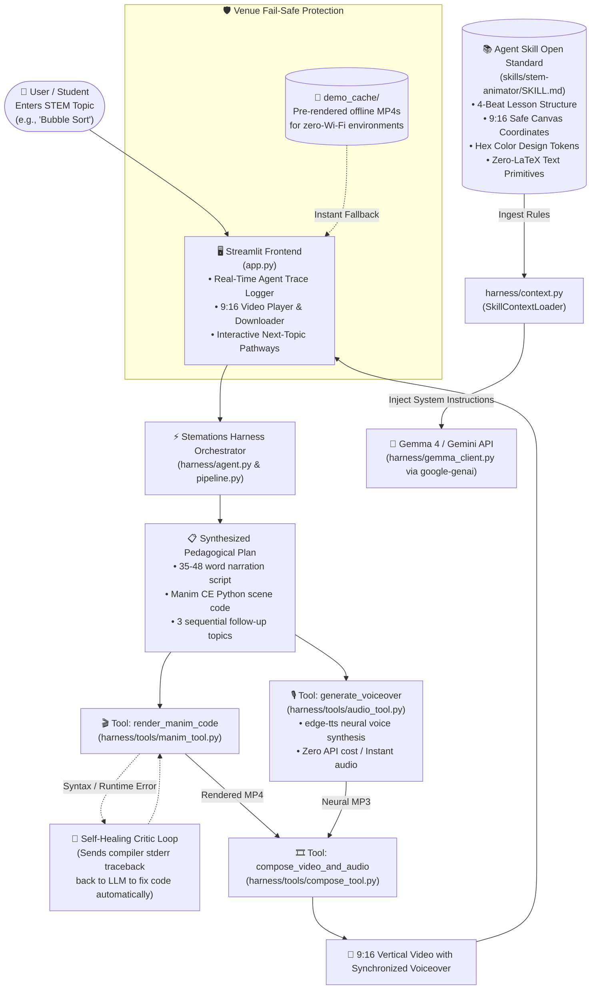

# 🧠 Stemations: Architecture, Codebase Guide & Pitch Playbook

> **Complete Technical Guide & Presentation Walkthrough for Hacktoberfest Hack Day Faisalabad**  
> *Target Categories: Best Open-Source AI Project | Best Use of Gemma 4*

---

## 📑 Table of Contents
1. [Executive Summary & Core Concept](#1-executive-summary--core-concept)
2. [End-to-End System Architecture](#2-end-to-end-system-architecture)
3. [Codebase & Component Directory Breakdown](#3-codebase--component-directory-breakdown)
4. [Step-by-Step Data Flow & Lifecycle](#4-step-by-step-data-flow--lifecycle)
5. [The Agent Skill Open Standard Implementation](#5-the-agent-skill-open-standard-implementation)
6. [Resilience & Fail-Safe Architecture](#6-resilience--fail-safe-architecture)
7. [The 3-Minute Live Hackathon Pitch Script](#7-the-3-minute-live-hackathon-pitch-script)
8. [Judge Q&A Preparation: Bulletproof Answers](#8-judge-qa-preparation-bulletproof-answers)
9. [Pre-Flight Demo Checklist](#9-pre-flight-demo-checklist)

---

## 1. Executive Summary & Core Concept

### What is Stemations?
**Stemations** (STEM + Animations) is an autonomous, open-source AI agent system that transforms any single STEM topic (physics, calculus, algorithms, chemistry, electronics) into a **pedagogically sound, 9:16 vertical animated short video with synchronized neural voiceover and adaptive next-step curriculum pathways**.

### The Problem It Solves
1. **Manual Video Coding is Slow:** Manually coding 3Blue1Brown-style programmatic animations using Python's `manim` library takes hours or days of painstaking mathematical coordinate math.
2. **Generative Video AI Hallucinates:** Diffusion and video foundation models (Sora, Runway, Pika) generate blurry pixels, invent fake mathematical formulas, and distort geometric diagrams. They cannot guarantee mathematical accuracy.
3. **Mobile Students Learn in Micro-Doses:** Today's learners consume content vertically (Shorts, Reels, TikTok) and need single-concept clarity in 15–25 seconds.

### The Stemations Solution
Stemations pairs **Google's Gemma 4 / Gemini models** with a formal **Agent Skill (`stem-animator`)** and a **sandboxed Manim compiler harness**. Instead of hallucinating pixels, the AI acts as a **software engineer and teacher**, writing deterministic, verifiable Python animation code and speaking in sync with the visual beats.

---

## 2. End-to-End System Architecture



---

## 3. Codebase & Component Directory Breakdown

Here is a map of every file and folder in the repository and its role:

```
stemations/
├── app.py                         # The interactive Streamlit dashboard & live trace UI
├── requirements.txt               # Locked, verified Python dependencies
├── verify_setup.py                # Pre-flight diagnostic tool testing all libraries & API
├── LICENSE                        # Official MIT Open-Source License
├── README.md                      # GitHub presentation-ready documentation
├── ARCHITECTURE_AND_PRESENTATION.md # This deep dive and pitch playbook
│
├── skills/                        # AGENT SKILLS (Open Standard)
│   └── stem-animator/
│       ├── SKILL.md               # Standard skill file (frontmatter, constraints, layout)
│       └── templates/             # Validated Manim CE reference patterns
│           ├── algorithm_template.py # Discrete element array animations
│           └── math_template.py      # Geometric proof & coordinate diagrams
│
├── harness/                       # MODEL HARNESS & AGENT ORCHESTRATION
│   ├── __init__.py
│   ├── agent.py                   # High-level StemationsAgent facade
│   ├── pipeline.py                # 5-stage sequential pipeline execution
│   ├── plan_builder.py            # Plan generator with skill template fallback
│   ├── gemma_client.py            # Google GenAI SDK wrapper + Self-Healing Critic
│   ├── context.py                 # SkillContextLoader (reads SKILL.md dynamically)
│   ├── models.py                  # Model attempt order and fallback cascades
│   ├── health.py                  # Health check logic for Manim, TTS, and API
│   ├── demo_cache.py              # Offline demo cache catalog and retriever
│   └── tools/                     # SANDBOXED EXECUTION TOOLS
│       ├── __init__.py
│       ├── manim_tool.py          # Sandboxed subprocess Manim Community compiler
│       ├── audio_tool.py          # Asynchronous edge-tts speech synthesis
│       └── compose_tool.py        # MoviePy & FFmpeg video/audio stitcher
│
├── demo_cache/                    # FAIL-SAFE DEMO ASSETS
│   ├── manifest.json              # Catalog of pre-rendered STEM topics
│   ├── binary_search.mp4          # Pre-rendered 9:16 Binary Search video
│   ├── pythagoras.mp4             # Pre-rendered 9:16 Pythagorean Theorem video
│   └── ...scripts and scenes
│
└── scripts/
    └── seed_demo_cache.py         # Utility to pre-generate offline video caches
```

---

## 4. Step-by-Step Data Flow & Lifecycle

When the user enters a topic (e.g., *"Bubble Sort"*) and clicks **"🚀 Run Stemations Agent"**, here is what executes:

### Step 1: Skill Ingestion (`harness/context.py`)
- `SkillContextLoader` parses `skills/stem-animator/SKILL.md`.
- It extracts the metadata, safe coordinate zones (`x ∈ [-3.6, 3.6]`, `y ∈ [-6.0, 6.0]`), the 4-beat narrative arc, and the color token rules.
- It dynamically formats this into a strict system instruction.

### Step 2: Plan Generation (`harness/gemma_client.py`)
- Sends the prompt to Google's GenAI endpoint (using `gemini-3.5-flash-lite` or `gemma-4-26b-a4b-it`).
- Gemma / Gemini acts as both educator and engineer, returning a single structured JSON object:
  1. `topic`: Clean title.
  2. `narration_script`: Exactly 35–48 words written to synchronize with visual actions.
  3. `manim_code`: Complete Python code with a `StemationScene(Scene)` class.
  4. `next_topics`: 3 logically sequenced follow-up concepts.

### Step 3: Sandboxed Manim Compilation (`harness/tools/manim_tool.py`)
- The Python script is written to an isolated file in `_output/scenes/`.
- A subprocess runs `python -m manim -ql <scene_file> StemationScene`.
- **`-ql` (low quality 480p 15fps):** Renders in ~10–18 seconds, perfect for live hackathon demos.
- Captures `stdout` and `stderr`.

### Step 4: Self-Healing Critic (On Compile Error)
- If the compiler fails (non-zero exit code), the agent enters `self_heal_manim_code()`.
- It feeds the compiler traceback directly back to the model:
  *"You are the compiler critic. This code failed with: `<stderr>`. Fix it and return only valid Python."*
- Re-compiles the repaired code. Up to 2 self-healing attempts are permitted before gracefully falling back.

### Step 5: Neural Voiceover Synthesis (`harness/tools/audio_tool.py`)
- Uses Microsoft `edge-tts` with the `en-US-ChristopherNeural` voice.
- Generates a natural, human-sounding MP3 voiceover in ~2.5 seconds with zero external API fees.

### Step 6: Audio-Visual Synchronization (`harness/tools/compose_tool.py`)
- Merges the Manim video with the narration MP3.
- If the voiceover is slightly longer than the visual actions, it freezes the final conclusion frame cleanly so the audio never gets cut off.
- Produces the final MP4 in `_output/final/`.

### Step 7: Reactive UI Delivery (`app.py`)
- The 9:16 video is immediately playable and downloadable.
- Real-time execution logs are visible in the **Agent Trace** box.
- The 3 follow-up topics are displayed as interactive recommendations.

---

## 5. The Agent Skill Open Standard Implementation

Stemations strictly implements the **Agent Skill Open Standard**:

1. **Portable Specification (`SKILL.md`):**
   - Contains standardized YAML frontmatter (`name`, `description`, `version`, `license`, `compatibility`).
   - Standard markdown instructions readable by any compliant AI agent harness.

2. **The 4-Beat Lesson Structure:**
   - **Beat 1: Hook & Title (`y ≈ 5.8 to 6.2`):** Concept title + 1-line intuitive question.
   - **Beat 2: Setup Model (`y ≈ 0.5 to 2.2`):** Array, triangle, graph, or circuit diagram.
   - **Beat 3: Dynamic Action (8s – 16s):** Elements swap, pointers slide, squares expand, colors indicate active comparison (`#34D399`).
   - **Beat 4: Summary Card (`y ≈ -3.8 to -5.2`):** Key formula or big-O takeaway + `self.wait(2)`.

3. **Portability (Zero LaTeX Dependency):**
   - Traditional Manim scripts crash if the host system lacks a full LaTeX / MiKTeX distribution.
   - The `stem-animator` skill explicitly enforces `Text()` with unicode mathematical symbols (`²`, `√`, `θ`, `π`, `→`, `≤`). This guarantees 100% execution on standard Python without requiring 4GB of TeX packages!

---

## 6. Resilience & Fail-Safe Architecture

Hackathons often suffer from poor Wi-Fi or API rate-limits. Stemations has **three layers of defense**:

| Defense Layer | Mechanism | What Happens |
|---|---|---|
| **Layer 1: Multi-Model Cascade** | `harness/models.py` | If `gemma-4-26b-a4b-it` has a 500 server error, it instantly cascades to `gemini-3.5-flash-lite` or `gemini-3.8-flash`. |
| **Layer 2: Skill Template Fallback** | `harness/plan_builder.py` | If all API endpoints fail (e.g. no internet), the harness builds the plan from `skills/stem-animator/templates/` and executes the full local Manim + TTS pipeline. |
| **Layer 3: Pre-Rendered Venue Cache** | `demo_cache/` | If Wi-Fi is completely down, click **"▶ Show backup video"** in the sidebar to stream pre-cached, fully rendered demonstrations of Binary Search and Pythagoras. |

---

## 7. The 3-Minute Live Hackathon Pitch Script

Follow this timing and script for your presentation to the judges:

### ⏱️ 0:00 – 0:30 | The Hook & The Problem
> *"Judges, when students want to understand a tough STEM concept like Binary Search or the Pythagorean Theorem, visual intuition is everything. But today, creating 3Blue1Brown-style programmatic animations takes hours of manual Python coding. And if you try using AI video models like Sora, they hallucinate blurry pixels, invent fake math, and distort shapes.*
>
> *We built **Stemations**: an open-source agent system that takes any STEM concept and writes, compiles, narrates, and renders a mathematically precise 9:16 vertical explainer in seconds."*

### ⏱️ 0:30 – 1:45 | The Live Generation Demo
> *(Click the "🔍 Binary Search" button on screen, then click "🚀 Run Stemations Agent")*
>
> *"Watch our agent trace in real time:  
> 1. First, the harness loads our custom Agent Skill: `stem-animator`.  
> 2. Next, the LLM reasons pedagogically: it crafts a 35-word narration script and writes executable Manim code adhering strictly to 9:16 mobile boundaries.  
> 3. Then, our sandboxed compiler tool renders the scene. If there were a syntax bug, our self-healing critic would catch the compiler error and fix it automatically.  
> 4. Finally, neural text-to-speech synthesizes the voiceover, and the video is composed.*
>
> *(Play the generated video with sound)*  
> *Look at that: clean array boxes, color-coded midpoint pointers, smooth partition dimming, and the O(log n) takeaway at the bottom—all synchronized with the voice."*

### ⏱️ 1:45 – 2:30 | Prize Alignment: Gemma 4 & Agent Skill
> *"Stemations qualifies directly for both hackathon prizes:  
> 1. **Best Use of Gemma 4:** Gemma isn't just generating text; it is the core brain acting as curriculum planner, geometric code author, and self-healing compiler critic.  
> 2. **Best Open-Source AI Project:** We are 100% open-source under the MIT license, using open-weight models, free neural voiceover, and adhering strictly to the **Agent Skill Open Standard** via `SKILL.md`."*

### ⏱️ 2:30 – 3:00 | Adaptive Learning Pathways & Conclusion
> *"Notice the bottom of the screen: the agent doesn't leave the student hanging. It suggests three logical follow-up topics—like Binary Search Trees and Big-O Notation—creating an endless, personalized learning journey.  
>
> Stemations makes high-quality STEM education programmatic, deterministic, and instant. Thank you, and we welcome your questions!"*

---

## 8. Judge Q&A Preparation: Bulletproof Answers

### Q1: "Why use code generation with Manim instead of generative AI video models like Runway or Sora?"
> **Answer:**  
> *"Generative pixel models are probabilistic and hallucinate: they cannot accurately hold array indices in memory, draw exact 90-degree right angles, or render formulas. Manim is deterministic—every pixel is governed by mathematical code. By having Gemma write the code rather than generate pixels, we guarantee mathematical precision."*

### Q2: "How did you use the Agent Skill Open Standard?"
> **Answer:**  
> *"In `skills/stem-animator/SKILL.md`, we defined a standardized skill specification with YAML frontmatter, canvas boundary constraints for 9:16 vertical video (`x ∈ [-3.6, 3.6]`), design tokens, and a 4-beat narrative pedagogy. Our harness parses this skill dynamically and injects it into the model prompt, making the skill reusable across any agent framework."*

### Q3: "What happens if the model writes invalid Manim code?"
> **Answer:**  
> *"We implemented an automatic Self-Healing Critic Loop in `harness/gemma_client.py`. When `manim_tool` catches a compiler exception in `stderr`, the harness sends the broken code and the exact compiler traceback back to the LLM. The model identifies the syntax or attribute error, repairs the code, and re-renders automatically."*

### Q4: "Why did you choose 9:16 vertical video?"
> **Answer:**  
> *"Over 80% of modern educational micro-content is consumed on mobile devices via YouTube Shorts and TikTok. Traditional Manim code defaults to 16:9 widescreen, which is illegible on phones. Our skill customizes the camera and framing specifically for 1080x1920 mobile displays."*

---

## 9. Pre-Flight Demo Checklist

Before walking up to the judges' table, run these 3 quick checks:

```powershell
# 1. Run the official setup verification
python verify_setup.py
# (Ensure all checks show [OK] for API Key, Streamlit, Manim, edge-tts, MoviePy)

# 2. Start the Streamlit app
streamlit run app.py

# 3. Test one topic live
# Select "Binary Search" or "Pythagorean Theorem" and ensure video renders smoothly.
```

If Wi-Fi drops at the venue:
- Click the **"📼 Venue backup demos"** dropdown in the sidebar.
- Click **"▶ Show backup video"** to instantly stream pre-cached, fully rendered demonstrations of Binary Search and Pythagoras.
