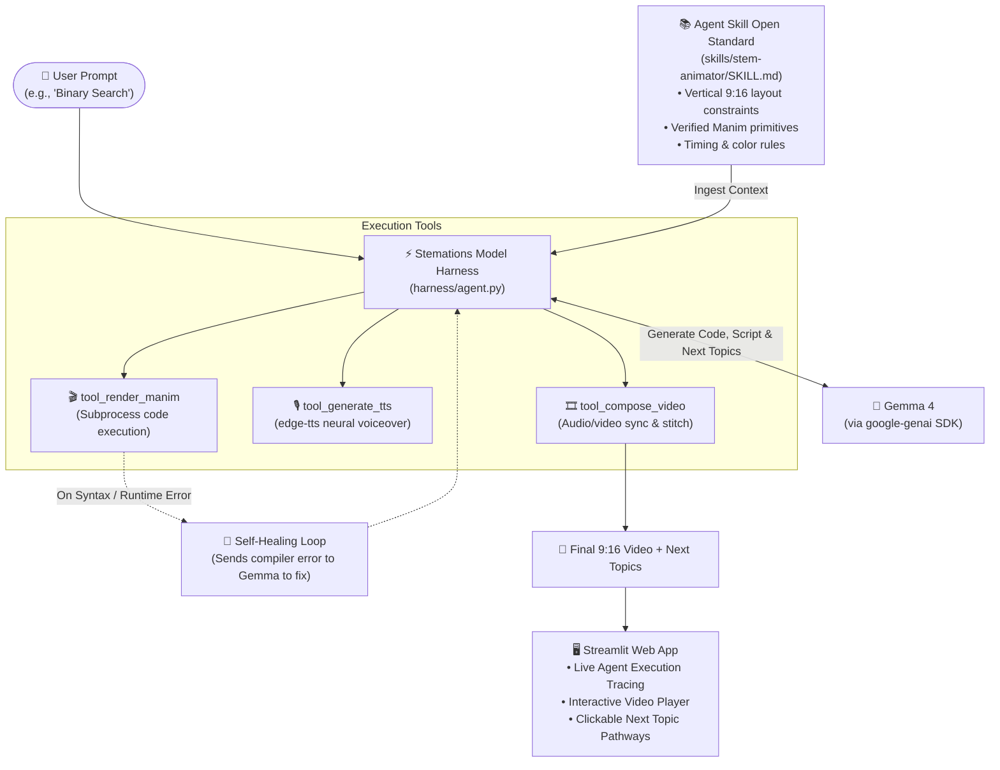

# 🎬 Stemations (STEM + Animations)

> **Our app helps students and educators turn complex STEM concepts into accurate, code-rendered animated explainer videos with synchronized voiceover and next-topic learning pathways using Gemma 4.**

[](https://opensource.org/licenses/MIT)
[-blue.svg)](https://ai.google.dev/gemma)
[](skills/stem-animator/SKILL.md)
[](https://streamlit.io/)
[](https://www.python.org/)

---

## 📌 Table of Contents
- [The Problem](#-the-problem)
- [The Solution: Simple & Reliable](#-the-solution-simple--reliable)
- [Hackathon Prize Alignment](#-hackathon-prize-alignment)
- [System Architecture & Flow](#-system-architecture--flow)
- [Key Features](#-key-features)
- [Agent Skill & Model Harness](#-agent-skill--model-harness)
- [Project Structure](#-project-structure)
- [Getting Started](#-getting-started)
- [How to Run the Demo](#-how-to-run-the-demo)
- [License & Attributions](#-license--attributions)


---

## 💡 The Problem

STEM education thrives on visual intuition (e.g., how algorithms sort arrays, how geometric proofs work, or how calculus derivatives behave). However:
1. **Manual Coding is Painstaking:** Producing 3Blue1Brown-style animations using Python's `manim` library requires deep programming skills and hours of manual trial-and-error.
2. **Generative AI Video Hallucinates:** Diffusion and prompt-to-pixel models (Sora, Runway) cannot reliably render mathematical symbols, algorithm state diagrams, or exact geometric angles. They generate blurry or physically impossible visuals.

---

## 🚀 The Solution: Simple & Reliable

**Stemations** bridges this gap with an intuitive, deterministic code-generation pipeline:
- You type a STEM concept (e.g., *"Binary Search"*, *"Pythagorean Theorem"*).
- **Gemma 4** acts as the core reasoning engine via the **Stemations Harness**.
- Guided by an **Agent Skill** (`skills/stem-animator/`), Gemma writes verifiable, vertical (9:16) **Manim Python code** and an accompanying concise narration script.
- The harness compiles the animation, synthesizes neural voiceover, stitches them together, and presents an interactive video ready for mobile learning or social micro-learning (TikTok, YouTube Shorts).
- If a compilation error occurs, the harness runs a **Self-Correction Feedback Loop**, feeding the compiler traceback back to Gemma to fix the code automatically!

---

## 🏆 Hackathon Prize Alignment

Stemations is purpose-built to satisfy and compete in **both** prize categories at **Hacktoberfest Hack Day Faisalabad**:

| Prize Category | Requirement | How Stemations Qualifies |
|---|---|---|
| **Best Open-Source AI Project** | • Open-source repository with OSI-approved license<br>• Uses open-weight AI model<br>• Complies with Agent Skill Open Standard<br>• Meaningful Model Harness implementation | • Licensed under the permissive **MIT License**.<br>• Powered by Google's open-weight **Gemma 4** model.<br>• Includes a compliant **Agent Skill** (`skills/stem-animator/SKILL.md`).<br>• Implements an original, lightweight **Model Harness** managing context, tools, and error-recovery. |
| **Best Use of Gemma 4** | • Gemma 4 called via Google GenAI API (`google-genai`)<br>• Gemma is central to the project, not a bolt-on | • Gemma 4 is the core planner, code synthesizer, compiler critic, and curriculum curator that powers the entire creation loop. |

---

## 🏗️ System Architecture & Flow

The architecture is intentionally designed to be **simple, modular, and failure-proof**:



### Flow Breakdown:
1. **User Input:** Enter any STEM concept or click a quick-select starter chip.
2. **Skill Context Loading:** The harness reads `skills/stem-animator/SKILL.md` to load the exact rules, vertical bounding boxes, and Manim primitives.
3. **Gemma 4 Generation:** Gemma generates a structured plan containing:
   - A 25–35 word pedagogical explanation.
   - Self-contained, executable Manim Community Edition code.
   - 3 recommended next sequential topics.
4. **Tool Execution:**
   - `tool_render_manim`: Executes the code in a sandboxed subprocess.
   - `tool_generate_tts`: Generates crisp neural voiceover using `edge-tts`.
   - `tool_compose_video`: Merges the animation and narration into a 9:16 MP4.
5. **Self-Healing Guardrail:** If Manim returns a non-zero exit code or syntax traceback, the harness captures stderr and prompts Gemma to fix it.
6. **Delivery & Learning Pathways:** The Streamlit dashboard plays the finished video and presents clickable chips for the next topics, creating an endless learning journey!

---

## ✨ Key Features

- **🎯 Programmatic Precision:** Mathematical graphs, geometric vectors, and data structure steps rendered accurately with Manim (no blurry AI pixels).
- **📱 9:16 Short-Form Ready:** Formatted specifically for vertical video viewing on smartphones, reels, and shorts.
- **🧠 Driven by Gemma 4:** Gemma 4 reasons about the visual layout and pedagogy behind the prompt.
- **🔁 Self-Correcting Execution:** Automatically fixes code errors without user intervention.
- **🎙️ Zero-Cost Neural Voiceover:** High-quality narration synthesized with `edge-tts` (free, fast, no external paid API key needed).
- **🗺️ Adaptive Learning Pathways:** Never leaves the student stranded—recommends 3 intelligent follow-up concepts after every video.
- **👁️ Live Agent Thought Tracer:** The UI displays real-time execution logs showing the agent reading the skill, invoking tools, and rendering assets.

---

## 🧩 Agent Skill & Model Harness

### 1. The Agent Skill (`skills/stem-animator/`)
Adheres to the **Agent Skill Open Standard**:
- **Metadata (`SKILL.md` frontmatter):** Standardized YAML configuration (`name`, `description`, `version`, `license`, `compatibility`).
- **Domain Constraints:** Enforces 9:16 canvas boundaries (`width=9.0`, `height=16.0`), safe margins, and high-contrast color palettes for mobile screens.
- **Curated Primitives:** Restricts model output to robust Manim CE elements (`Create`, `Transform`, `FadeIn`, `MathTex`, `VGroup`, `Square`, `Arrow`).

### 2. The Model Harness (`harness/`)
A lightweight, transparent orchestration layer:
- **`context.py`:** Discovers and injects the `SKILL.md` rules into the LLM system prompt.
- **`gemma_client.py`:** Standardized client wrapper around Google's `google-genai` SDK using `gemma-4-26b-a4b-it`.
- **`agent.py`:** Coordinates the reasoning, tool execution, and self-healing retry loop.
- **`tools/`:** Modular execution tools (`manim_tool`, `audio_tool`, `compose_tool`).

---

## 📁 Project Structure

```
stemations/
├── .env.example             # Example environment file with GEMINI_API_KEY
├── .gitignore               # Protects API keys, logs, and media caches
├── LICENSE                  # MIT License
├── README.md                # Comprehensive documentation
├── requirements.txt         # All Python dependencies
├── app.py                   # Streamlit web dashboard & agent visualizer
│
├── skills/
│   └── stem-animator/
│       ├── SKILL.md         # Compliant Agent Skill specification
│       └── templates/       # Pre-verified Manim scene templates
│
├── harness/
│   ├── __init__.py
│   ├── context.py           # Loads Agent Skill & builds system prompt
│   ├── gemma_client.py      # Google GenAI Gemma 4 connection
│   ├── agent.py             # ReAct reasoning loop & tool orchestrator
│   └── tools/
│       ├── __init__.py
│       ├── manim_tool.py    # Sandboxed Manim code execution
│       ├── audio_tool.py    # edge-tts neural voice generation
│       └── compose_tool.py  # Video & audio composition
│
└── demo_cache/              # Offline backup videos for fail-safe demo
    ├── binary_search.mp4
    └── pythagoras.mp4
```

---

## 🛠️ Getting Started

### Prerequisites
1. **Python 3.10+** (Tested on Python 3.12)
2. **Git**
3. **FFmpeg** (Required by Manim & MoviePy for rendering):
   - **Windows:**
     ```powershell
     winget install Gyan.FFmpeg
     ```
   - **macOS:**
     ```bash
     brew install ffmpeg
     ```
   - **Linux (Ubuntu/Debian):**
     ```bash
     sudo apt update && sudo apt install -y ffmpeg
     ```

### Installation

1. **Clone the Repository:**
   ```bash
   git clone https://github.com/<your-username>/stemations.git
   cd stemations
   ```

2. **Create a Virtual Environment:**
   ```bash
   python -m venv venv
   # On Windows:
   .\venv\Scripts\activate
   # On macOS/Linux:
   source venv/bin/activate
   ```

3. **Install Dependencies:**
   ```bash
   pip install -r requirements.txt
   ```

4. **Configure your API Key:**
   Copy `.env.example` to `.env` and insert your Gemini API Key:
   ```bash
   cp .env.example .env
   ```
   Edit `.env`:
   ```ini
   GEMINI_API_KEY="your_google_ai_studio_key_here"
   ```

---

## 🎮 How to Run the Demo

1. **Run the Streamlit Dashboard:**
   ```bash
   streamlit run app.py
   ```
2. **Use the Application:**
   - Open your browser at `http://localhost:8501`.
   - Type a topic (e.g., *"Bubble Sort algorithm"*) or pick a sample chip.
   - Watch the **Agent Trace** execute: Skill loaded $\rightarrow$ Code generated $\rightarrow$ Scene rendered $\rightarrow$ Narration voiced $\rightarrow$ Video stitched.
   - Watch the resulting 9:16 vertical animation and click any recommended follow-up topic!


## 📜 License & Attributions

- **Code License:** This project is licensed under the [MIT License](LICENSE).
- **Model License:** Powered by **Gemma 4** (`gemma-4-26b-a4b-it`) released by Google under the [Apache 2.0 License](https://ai.google.dev/gemma/terms).
- **Libraries:** Built with [Manim Community Edition](https://www.manim.community/) and [Streamlit](https://streamlit.io/).

---


