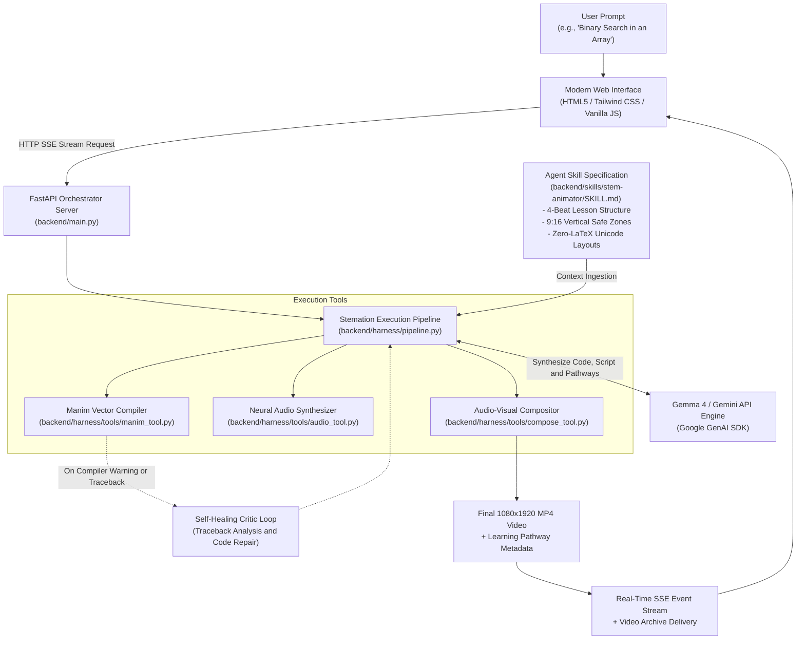

# Stemations: Autonomous STEM Video Agent

Autonomous educational synthesis platform that transforms complex STEM concepts into mathematically precise vertical video lessons with synchronized voiceover instruction and adaptive learning pathways.

[](https://opensource.org/licenses/MIT)
[-indigo.svg)](https://ai.google.dev/gemma)
[](backend/skills/stem-animator/SKILL.md)
[](https://www.manim.community/)
[](https://fastapi.tiangolo.com/)
[](frontend/)
[](https://www.python.org/)

---

## Table of Contents
- [Executive Overview](#executive-overview)
- [System Architecture](#system-architecture)
- [Project Directory Structure](#project-directory-structure)
- [Core Technical Capabilities](#core-technical-capabilities)
- [Agent Skill Specification](#agent-skill-specification)
- [API Reference](#api-reference)
- [Installation and Setup](#installation-and-setup)
- [Running the Application](#running-the-application)
- [Production Deployment](#production-deployment)
- [Offline Venue Cache](#offline-venue-cache)
- [License and Attribution](#license-and-attribution)

---

## Executive Overview

STEM education demands rigorous visual intuition. Understanding how binary search halves search spaces, how geometric proofs validate theorems, or how circuit components behave over time requires dynamic visual framing.

Traditional generative diffusion video models frequently hallucinate formulas, warp geometry, and distort text. Manual programmatic animation in Manim requires extensive coordinate calculation and debugging.

Stemations resolves these challenges by bridging high-level LLM reasoning with deterministic vector graphics compilation:
1. **Curriculum Planning:** Deconstructs any STEM prompt into a four-beat pedagogical sequence.
2. **Deterministic Code Generation:** Translates instructional concepts into executable Python Manim code adhering to vertical mobile safe zones.
3. **Sandboxed Compilation and Critic Loop:** Executes code in an isolated subprocess. If layout constraints or syntax errors arise, an automated critic loop resolves tracebacks autonomously.
4. **Synchronized Neural Narration:** Synthesizes voiceover narration through high-fidelity neural audio and multiplexes it onto the visual animation frames.
5. **Decoupled Architecture:** Features a modern, responsive frontend (HTML5, Tailwind CSS, JavaScript) connected via Server-Sent Events (SSE) to an asynchronous FastAPI backend.

---

## System Architecture



---

## Project Directory Structure

The codebase is organized into decoupled frontend and backend divisions:

```
stemations/
├── backend/                        # Backend API server and agent runtime
│   ├── harness/                    # Core agent orchestration framework
│   │   ├── tools/                  # Sandboxed execution tools
│   │   │   ├── audio_tool.py       # Neural voiceover synthesizer (edge-tts)
│   │   │   ├── compose_tool.py     # Video and audio multiplexer (MoviePy/FFmpeg)
│   │   │   └── manim_tool.py       # Isolated Manim CE subprocess compiler
│   │   ├── agent.py                # Facade orchestrator for execution pipeline
│   │   ├── context.py              # Agent Skill parser and system prompt builder
│   │   ├── demo_cache.py           # Pre-rendered offline lesson registry
│   │   ├── gemma_client.py         # Google GenAI SDK interface with critic repair
│   │   ├── health.py               # Dependency diagnostic and environment checker
│   │   ├── models.py               # Model registry (Gemma 4, Gemini 2.5 Flash)
│   │   ├── pipeline.py             # Multi-stage synthesis and self-healing loop
│   │   └── plan_builder.py         # Lesson and Manim blueprint builder
│   ├── skills/                     # Open standard agent skills
│   │   └── stem-animator/          # STEM animation skill definition
│   │       ├── SKILL.md            # Skill specification and constraints
│   │       └── templates/          # Reference verified algorithm and math scenes
│   ├── demo_cache/                 # Pre-rendered fallback MP4 files and manifests
│   ├── _output/                    # Generated scenes, voiceovers, and final MP4s
│   ├── main.py                     # FastAPI application entrypoint with SSE stream
│   └── requirements.txt            # Backend Python dependencies
│
├── frontend/                       # Responsive modern web client
│   ├── index.html                  # Semantic HTML5 layout with Tailwind CSS
│   ├── css/
│   │   └── style.css               # Glassmorphic dark styling, video frames, scrollbars
│   ├── js/
│   │   └── app.js                  # SSE stream receiver, video reel, tab controllers
│   └── assets/                     # SVG icons and static resources
│
├── scripts/
│   └── seed_demo_cache.py          # Offline video cache generator script
│
├── Dockerfile                      # Production container deployment definition
├── .dockerignore                   # Docker build ignore rules
├── Procfile                        # Platform as a Service startup command
├── run.py                          # Unified single-command launcher
├── verify_setup.py                 # System verification and diagnostics script
├── requirements.txt                # Root-level requirements definition
└── README.md                       # Project documentation
```

---

## Core Technical Capabilities

- **Deterministic Geometric Rendering:** Code executes directly through Manim Community Edition. All coordinates, curves, labels, and mathematical steps are rendered deterministically.
- **Native 9:16 Vertical Format:** Calibrated for mobile viewing and vertical video platforms (1080x1920 resolution, bounded coordinate space: x in [-3.6, 3.6], y in [-6.0, 6.0]).
- **Self-Healing Critic Engine:** In the event of an unexpected coordinate overlap or syntax exception, the harness passes the compiler traceback back to the LLM critic to synthesize and verify an automatic patch.
- **Neural Audio Synthesis:** Generates high-fidelity instructional speech using neural text-to-speech with zero external API fees.
- **Adaptive Curriculum Pathways:** Every synthesis run delivers three structured follow-up topics to guide continuous study.
- **Human-Readable Live Commentary:** Real-time event streaming delivers professional instructional milestones without leaking low-level operating system paths or raw exceptions.
- **Recent Video Archive Reel:** Horizontal scrollable reel displaying recent productions with inline preview, focused modal playback, and direct MP4 downloads.

---

## Agent Skill Specification

The agent adheres to the Agent Skill Open Standard defined in `backend/skills/stem-animator/SKILL.md`:
- **Standardized Metadata:** YAML frontmatter detailing name, version, and licensing.
- **Four-Beat Lesson Architecture:**
  - *Beat 1 (Hook and Definition):* Top header positioned at `y ≈ 6.0` defining the concept clearly.
  - *Beat 2 (Visual Model):* Central coordinate frame or visual setup (`y ≈ 0.5 to 2.2`).
  - *Beat 3 (Core Mechanism):* Dynamic step-by-step transformation (pointer traversal, element reallocation, area convergence).
  - *Beat 4 (Synthesis Takeaway):* Bottom summary card at `y ≈ -4.2` presenting formal complexity or law.
- **Zero-LaTeX Dependency:** Employs standard typographic primitives with unicode mathematical characters to allow full execution without external TeX dependencies.

---

## API Reference

The backend exposes a REST and SSE API through FastAPI:

| Endpoint | Method | Description |
|---|---|---|
| `/` | `GET` | Serves the modern HTML5/Tailwind web client |
| `/api/health` | `GET` | Diagnostic health report of Manim, FFmpeg, audio, and API keys |
| `/api/models` | `GET` | Lists supported models and default selections |
| `/api/recent-videos` | `GET` | Returns list of recent video productions with metadata |
| `/api/videos/{filename}` | `GET` | Streams generated MP4 video with range header support |
| `/api/demo-videos/{filename}` | `GET` | Streams pre-rendered offline demo videos |
| `/api/generate/stream` | `GET` | Server-Sent Events endpoint streaming real-time synthesis steps |
| `/api/generate` | `POST` | Synchronous generation endpoint returning full JSON payload |
| `/docs` | `GET` | Interactive Swagger API documentation |

---

## Installation and Setup

### Prerequisites
- Python 3.10, 3.11, or 3.12
- FFmpeg installed and accessible via system PATH
- Free Google Gemini API Key from [Google AI Studio](https://aistudio.google.com/)

### 1. Clone the Repository
```bash
git clone https://github.com/Haider-Ali7/stemations.git
cd stemations
```

### 2. Configure Virtual Environment
```bash
python -m venv .venv

# On Linux / macOS:
source .venv/bin/activate

# On Windows (PowerShell):
.venv\Scripts\Activate.ps1
```

### 3. Install Dependencies
```bash
pip install -r requirements.txt
```

### 4. Configure API Key
Create a `.env` file in the project root:
```env
GEMINI_API_KEY=your_actual_api_key_here
```

### 5. Verify System Setup
Run the diagnostic check to ensure all rendering, AI SDK, and audio components are operational:
```bash
python -m backend.harness.health
```
Or check the live health endpoint in your browser at `http://localhost:8000/api/health`.

---

## Running the Application

Launch the unified application server with a single command:
```bash
python run.py
```

Open your browser to:
- **Web Application:** `http://localhost:8000`
- **Interactive API Documentation:** `http://localhost:8000/docs`

---

## Production Deployment

### Free 1-Click Cloud Deployment (Render.com)
The repository includes a ready-to-use [`render.yaml`](render.yaml) blueprint:
1. Push your repository to GitHub.
2. Sign up or log into [Render.com](https://dashboard.render.com/).
3. Click **New +** → **Blueprint**, and select your GitHub repository (`stemations`).
4. Render automatically detects [`render.yaml`](render.yaml) and configures the Docker Web Service on the free tier.
5. In the Render service dashboard under **Environment**, enter your `GEMINI_API_KEY`.
6. Click **Apply Changes**. Render builds the container with Manim, FFmpeg, and neural audio, and deploys your full-stack application!

### Docker Deployment (Local or VPS)
Build the container image:
```bash
docker build -t stemations:latest .
```

Run the container:
```bash
docker run -p 8000:8000 -e GEMINI_API_KEY="your_api_key" stemations:latest
```

---

## Offline Venue Cache

For presentations or environments with limited internet connectivity, pre-rendered offline demo bundles are included under `backend/demo_cache/`.

To pre-render or refresh offline demo bundles:
```bash
python scripts/seed_demo_cache.py
```

When offline mode is active, the system automatically detects network constraints and plays the corresponding pre-rendered lesson from the local archive.

## License and Attribution

- **Model:** Powered by **Gemma 4** (`gemma-4-26b-a4b-it`) released by Google under the Apache 2.0 License.
- **Engine:** Built with [Manim Community Edition](https://www.manim.community/) and [FastAPI](https://fastapi.tiangolo.com/).
- **License:** Open-source under the [MIT License](LICENSE).
