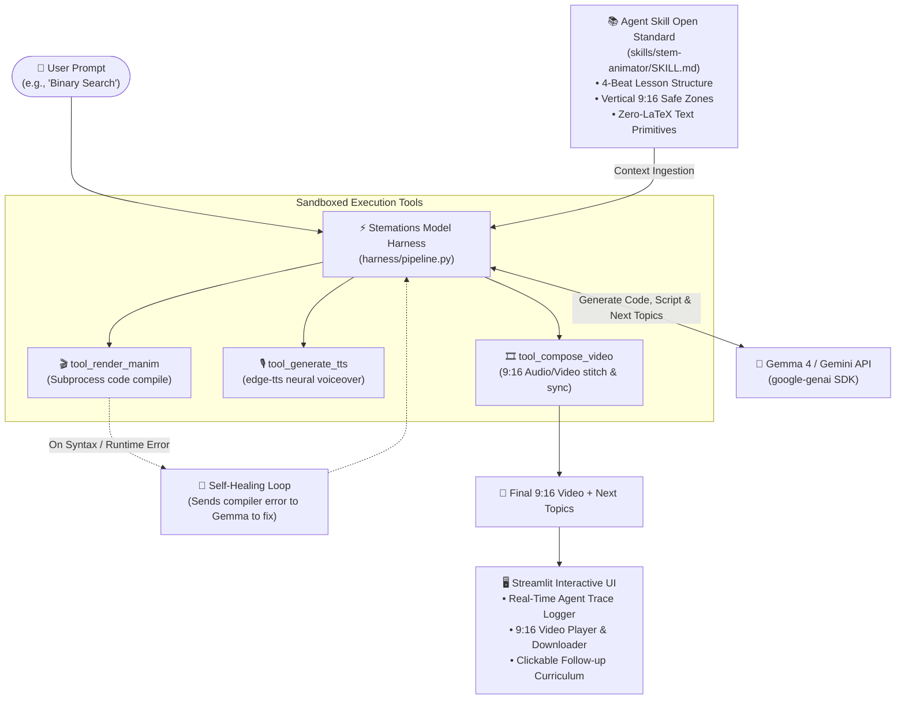

# 🎬 Stemations (STEM + Animations)

> **Autonomous AI Agent turning complex STEM concepts into mathematically precise, 9:16 vertical animated explainers with synchronized neural voiceover and adaptive learning pathways.**

[](https://opensource.org/licenses/MIT)
[-blue.svg)](https://ai.google.dev/gemma)
[](skills/stem-animator/SKILL.md)
[](https://www.manim.community/)
[](https://streamlit.io/)
[](https://www.python.org/)

---

## 📌 Table of Contents
- [Why Stemations?](#-why-stemations)
- [Hackathon Prize Alignment](#-hackathon-prize-alignment)
- [How It Works (System Architecture)](#-how-it-works-system-architecture)
- [Key Features](#-key-features)
- [Agent Skill Open Standard Compliance](#-agent-skill-open-standard-compliance)
- [Repository Structure](#-repository-structure)
- [Quickstart Guide](#-quickstart-guide)
- [Fail-Safe Venue Backup Mode](#-fail-safe-venue-backup-mode)
- [Documentation & Presentation Playbook](#-documentation--presentation-playbook)
- [Team & Acknowledgments](#-team--acknowledgments)

---

## 💡 Why Stemations?

STEM education thrives on visual intuition (how an algorithm partitions an array, how geometric proofs work, or how RC circuits charge). However:
1. **Manual Coding is Painstaking:** Crafting 3Blue1Brown-style programmatic animations using Python's `manim` library takes hours of manual coordinate math and debugging.
2. **Generative Video AI Hallucinates:** Diffusion models (Sora, Runway, Pika) generate blurry pixels, distort geometry, and invent fake mathematical formulas.
3. **Mobile Micro-Learning Demand:** Students consume content vertically on phones (Shorts, Reels, TikTok) and need crystal-clear concept mastery in 15–25 seconds.

**Stemations solves this:** Guided by an open-standard **Agent Skill**, **Gemma 4** acts as both educator and software engineer. It writes deterministic, verifiable Python Manim code, coordinates neural narration, compiles the scene in a sandboxed harness, and self-heals if any compilation errors occur.

---

## 🏆 Hackathon Prize Alignment

Stemations is purpose-built to satisfy and compete in **both** prize categories at **Hacktoberfest Hack Day Faisalabad**:

| Prize Category | Key Requirements | How Stemations Qualifies |
|---|---|---|
| **Best Open-Source AI Project** | • Open-source repository with OSI-approved license<br>• Uses open-weight AI model<br>• Complies with Agent Skill Open Standard<br>• Meaningful Model Harness implementation | • Licensed under the permissive **MIT License**.<br>• Powered by Google's open-weight **Gemma 4** (`gemma-4-26b-a4b-it`).<br>• Implements a compliant **Agent Skill** (`skills/stem-animator/SKILL.md`).<br>• Custom, transparent **Model Harness** managing context, sandboxed tools, and self-healing error recovery. |
| **Best Use of Gemma 4** | • Gemma 4 called via Google GenAI SDK (`google-genai`)<br>• Gemma is central to the project, not a bolt-on | • Gemma 4 is the **core reasoning engine**: acting as the lesson planner, geometric code author, compiler critic, and sequential curriculum curator. |

---

## 🏗️ How It Works (System Architecture)



---

## ✨ Key Features

- **🎯 Deterministic Precision:** Mathematical diagrams, geometric vectors, and algorithm states rendered with Manim CE—no blurry or hallucinated pixels.
- **📱 Native 9:16 Mobile Format:** Specifically calibrated for vertical viewing on smartphones, Reels, and YouTube Shorts (`1080x1920`, safe bounds `x ∈ [-3.6, 3.6]`, `y ∈ [-6.0, 6.0]`).
- **🔁 Self-Correcting Execution:** If the compiler encounters a syntax or attribute error, the harness captures stderr and prompts Gemma to repair the code automatically.
- **🎙️ Zero-Cost Neural Voiceover:** High-fidelity speech synthesized in ~2 seconds using `edge-tts` (fast, natural, zero external API costs).
- **🗺️ Adaptive Curriculum Pathways:** Recommends 3 intelligent sequential topics after every video, creating an endless learning path.
- **👁️ Real-Time Agent Trace:** Watch the live thought process as the agent loads the skill, invokes tools, and renders assets step-by-step.

---

## 🧩 Agent Skill Open Standard Compliance

Located at `skills/stem-animator/SKILL.md`:
- **Standardized Frontmatter:** YAML specification containing `name`, `description`, `version`, `license`, and `compatibility`.
- **The 4-Beat Lesson Structure:**
  - *Beat 1 (Hook & Title):* Top header at `y ≈ 6.0` with intuitive 1-line concept definition.
  - *Beat 2 (Visual Model):* Central diagram or array setup (`y ≈ 0.5 to 2.2`).
  - *Beat 3 (The "Aha!" Mechanism):* Dynamic visual action (pointers slide, elements swap, squares sum, curves trace).
  - *Beat 4 (Summary Takeaway):* Bottom card at `y ≈ -4.2` with formula or big-O complexity + `self.wait(2)`.
- **Zero-LaTeX Dependency:** Enforces `Text()` with unicode math symbols (`²`, `√`, `θ`, `π`, `→`, `≤`) so animations execute on any system without needing a 4GB LaTeX installation.

---

## 📁 Repository Structure

```
stemations/
├── app.py                         # Streamlit web dashboard & agent visualizer
├── requirements.txt               # Project dependencies
├── verify_setup.py                # Pre-flight diagnostic check script
├── LICENSE                        # MIT License
├── README.md                      # Primary project documentation
├── ARCHITECTURE_AND_PRESENTATION.md # Architecture deep dive & 3-minute pitch playbook
│
├── skills/
│   └── stem-animator/
│       ├── SKILL.md               # Compliant Agent Skill specification
│       └── templates/             # Reference Manim scene templates
│           ├── algorithm_template.py
│           └── math_template.py
│
├── harness/                       # Model harness & agent orchestration
│   ├── __init__.py
│   ├── agent.py                   # Agent facade
│   ├── pipeline.py                # 5-stage execution pipeline
│   ├── plan_builder.py            # Plan generator & template fallback
│   ├── gemma_client.py            # Google GenAI Gemma 4 connection & Self-Healing
│   ├── context.py                 # Agent Skill loader & system prompt builder
│   ├── models.py                  # Model attempt order and fallback cascades
│   ├── health.py                  # Health check logic
│   ├── demo_cache.py              # Offline demo cache retriever
│   └── tools/                     # Modular execution tools
│       ├── __init__.py
│       ├── manim_tool.py          # Sandboxed Manim code execution
│       ├── audio_tool.py          # edge-tts neural voice generation
│       └── compose_tool.py        # Video & audio composition
│
├── demo_cache/                    # Fail-safe pre-rendered video assets
│   ├── manifest.json              # Demo cache catalog
│   ├── binary_search.mp4
│   └── pythagoras.mp4
│
└── scripts/
    └── seed_demo_cache.py         # Script to pre-generate demo cache assets
```

---

## 🛠️ Quickstart Guide

### 1. Prerequisites
- **Python 3.10+** (Tested on Python 3.12)
- **FFmpeg** (Required by Manim & MoviePy):
  - *Windows:* `winget install Gyan.FFmpeg`
  - *macOS:* `brew install ffmpeg`
  - *Linux:* `sudo apt update && sudo apt install -y ffmpeg`

### 2. Installation
```bash
# Clone the repository
git clone https://github.com/Haider-Ali7/stemations.git
cd stemations

# Create and activate virtual environment
python -m venv venv
# On Windows:
.\venv\Scripts\activate
# On macOS/Linux:
source venv/bin/activate

# Install dependencies
pip install -r requirements.txt
```

### 3. Configure API Key
Create a `.env` file in the root directory:
```ini
GEMINI_API_KEY=your_gemini_api_key_from_google_ai_studio
```

### 4. Run Setup Verification
```bash
python verify_setup.py
```
*Outputs `[OK]` for API Key, Streamlit, Manim Community, edge-tts, and MoviePy/FFmpeg.*

### 5. Launch the Application
```bash
streamlit run app.py
```
Open `http://localhost:8501` in your browser.

---

## 📼 Fail-Safe Venue Backup Mode

To protect against unreliable conference Wi-Fi or API rate limits during live hackathon judging:
- The app includes a pre-rendered **Venue Backup Demo** section in the sidebar.
- Click **"▶ Show backup video"** to instantly stream pre-rendered animations of **Binary Search** and the **Pythagorean Theorem** without making any external network calls.

---

## 📖 Documentation & Presentation Playbook

For a comprehensive breakdown of the code and the exact 3-minute pitch to deliver to judges, refer to:
👉 **[ARCHITECTURE_AND_PRESENTATION.md](ARCHITECTURE_AND_PRESENTATION.md)**:
- Line-by-line component walkthrough
- Step-by-step data flow lifecycle
- **Word-for-word 3-minute hackathon pitch script**
- Likely judge questions with winning answers

---

## 👥 Team & Acknowledgments

**Hacktoberfest Hack Day Faisalabad 2026**  
*Project ID:* NTU 27-FYP-217  
*Team:* Maha Ather, Amina Asif, Haider Ali

- **Model:** Powered by **Gemma 4** (`gemma-4-26b-a4b-it`) released by Google under the Apache 2.0 License.
- **Engine:** Built with [Manim Community Edition](https://www.manim.community/) and [Streamlit](https://streamlit.io/).
- **License:** Open-source under the [MIT License](LICENSE).
